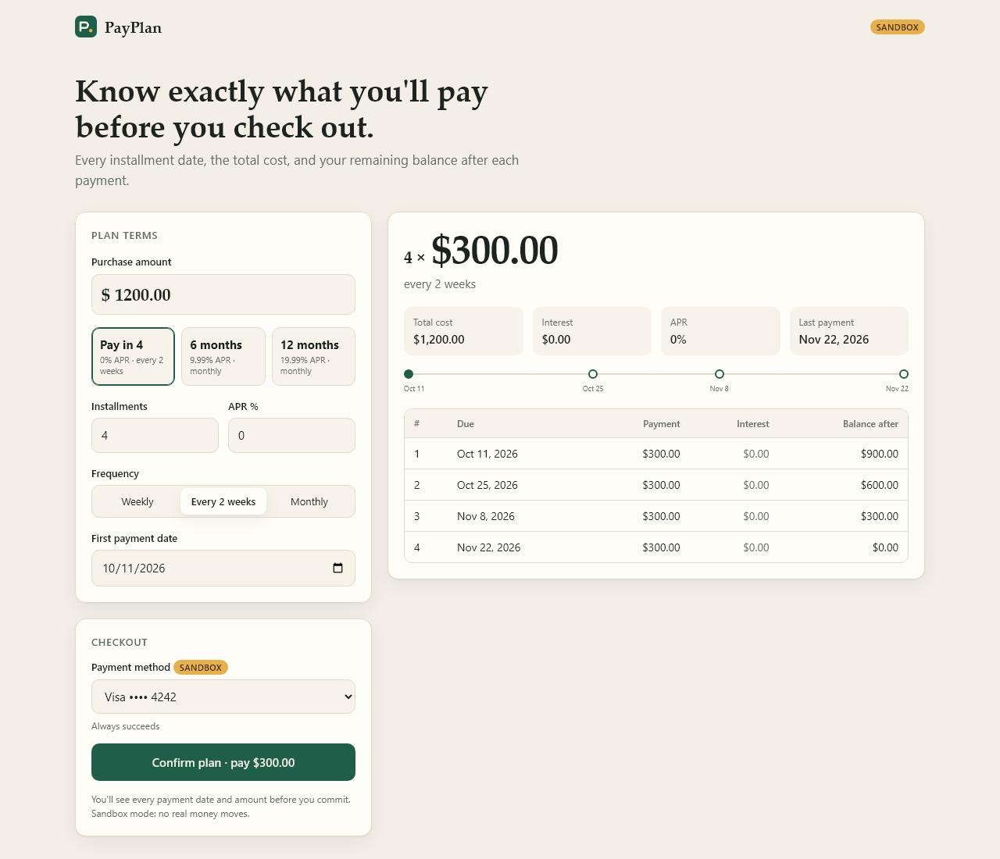
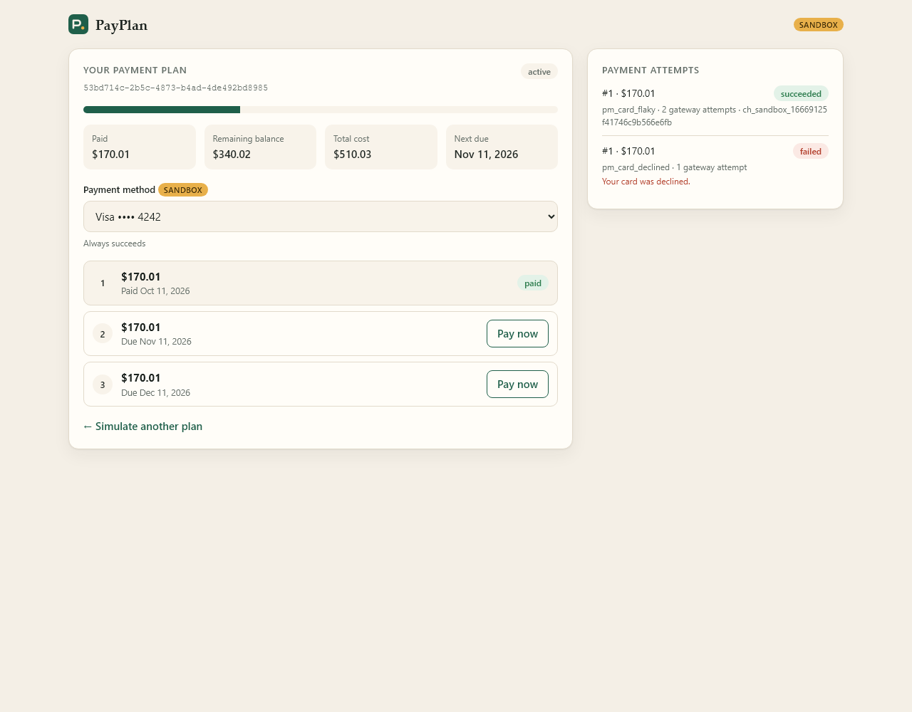
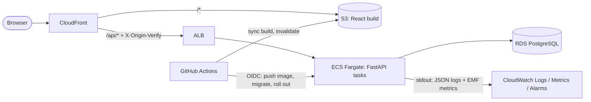

# PayPlan

A full-stack payment-plan simulator with a sandbox checkout. Shoppers see every installment
date, the total cost including interest, and the balance left after each payment *before*
they commit. At checkout the API makes sure a payment is never charged twice, even when
requests are retried, double-clicked, or raced against each other.

**Stack:** Python 3.13 · FastAPI · SQLAlchemy 2 · PostgreSQL 16 · Alembic · React 19 ·
TypeScript · Vite · Docker · Terraform · AWS (ECS Fargate, RDS, S3, CloudFront, CloudWatch) ·
GitHub Actions

| Simulate and check out | Manage the plan |
| --- | --- |
|  |  |

## Architecture



- CloudFront serves the SPA and proxies `/api/*` to the ALB, so the browser talks to a single
  origin. The ALB only accepts CloudFront's origin-facing IP ranges *and* a secret header.
- API tasks run in private subnets. RDS accepts connections only from the API security group
  and requires TLS. The DB password is generated by RDS into Secrets Manager and injected
  by ECS, so it never appears in Terraform state or in the image.

## How double charges are prevented

Paying an installment (`POST /api/v1/plans/{id}/installments/{n}/payments`) is protected at
three layers:

1. **Idempotency keys.** Clients send an `Idempotency-Key` header. The key is claimed with
   `INSERT … ON CONFLICT DO NOTHING` against a `UNIQUE (scope, key)` constraint, so exactly
   one request wins. The winner stores its response **in the same transaction** as the
   payment state change. Retries replay that response (`Idempotent-Replayed: true`), a
   concurrent duplicate gets `409`, and reusing a key with a different body gets `422`.
2. **Database constraints.** A partial unique index allows only one `pending` or `succeeded`
   payment per installment (`WHERE status IN ('pending','succeeded')`). Together with a
   `SELECT … FOR UPDATE` row lock on the installment, two *different* keys racing on the
   same installment can't both reach the gateway. Failed payments are excluded from the
   index, so a declined customer can retry.
3. **Short atomic transactions around the gateway call.** Reservation (transaction 1) →
   gateway charge (no locks held) → finalize payment, installment, plan status and the
   stored response (transaction 2). The gateway charge is keyed by our payment id. If the
   process loses the gateway's response, the key is unlocked and the client's retry
   *resumes* the same payment instead of creating a new charge.

Transient gateway errors are retried with exponential backoff. Declines are returned as a
`failed` payment the shopper can retry with a new key and a different card.

## Money math

All amounts are `Decimal`, rounded half-up to cents (floats are rejected outright). With
0% APR, leftover cents go on the first installment ($100 / 3 → $33.34, $33.33, $33.33).
With interest, a standard amortizing payment is used and the final installment settles any
rounding drift. Principal always sums exactly to the purchase amount. Monthly due dates
keep the original day and clamp to month end (Jan 31 → Feb 29 → Mar 31).

## API

Interactive OpenAPI docs are served at `/docs` (Swagger UI) and `/redoc`.

| Method | Path | Purpose |
| --- | --- | --- |
| `POST` | `/api/v1/quotes` | Simulate a plan (nothing stored) |
| `POST` | `/api/v1/plans` | Check out: create a plan *(Idempotency-Key)* |
| `GET` | `/api/v1/plans/{id}` | Plan with installments, amount paid, remaining balance |
| `POST` | `/api/v1/plans/{id}/installments/{n}/payments` | Pay an installment *(Idempotency-Key)* |
| `GET` | `/api/v1/plans/{id}/payments` | Payment attempts, including failures |
| `GET` | `/api/v1/sandbox/payment-methods` | Test cards and their behavior |
| `GET` | `/healthz`, `/readyz` | Liveness / readiness (checks the DB) |

Sandbox cards: `pm_card_visa` (succeeds), `pm_card_declined`, `pm_card_insufficient_funds`,
`pm_card_flaky` (times out once, then succeeds after an automatic retry), and
`pm_card_processing_error` (exhausts retries).

## Run locally

Requirements: Docker, Node 24+, Python 3.12+.

```bash
docker compose up --build -d api          # Postgres + migrations + API on :8000
cd frontend && npm install && npm run dev  # UI on http://localhost:5173 (proxies /api)
```

## Tests

48 pytest cases run against a real PostgreSQL database. The schema is built from the
Alembic migrations, so the migrations are tested too.

```bash
docker compose --profile test up -d db-test     # throwaway Postgres on :5433
cd backend
python -m venv .venv && source .venv/bin/activate   # Windows: .venv\Scripts\activate
pip install -e ".[dev]"
pytest
```

| File | Covers |
| --- | --- |
| `test_schedule.py` | Even splits, remainder cents, amortization, half-up rounding, leap years and month-end dates, input validation |
| `test_api.py` | Quotes, OpenAPI contract, health probes, EMF metrics, plan checkout idempotency |
| `test_payments.py` | Replays, declines, retries after failure, transient gateway errors, resuming an interrupted payment, stale-lock takeover |
| `test_concurrency.py` | 12 threads racing with the same key, with different keys, and on checkout; DB-level unique index enforcement |

Frontend: `npm test` (Vitest), `npm run typecheck`.

## Deploying to AWS

Infrastructure is in [`infra/terraform`](infra/terraform). CI runs on every push and pull
request. Pushing to `main` runs the tests and then deploys.

1. Create an S3 bucket for Terraform state, then:
   ```bash
   cd infra/terraform
   cp backend.hcl.example backend.hcl            # fill in the state bucket
   cp terraform.tfvars.example terraform.tfvars  # set github_repository
   terraform init -backend-config=backend.hcl
   terraform apply
   ```
2. Copy each uppercase `terraform output` (`AWS_DEPLOY_ROLE_ARN`, `AWS_REGION`,
   `ECR_REPOSITORY`, `ECS_CLUSTER`, `ECS_SERVICE`, `ECS_TASK_FAMILY`, `ECS_SUBNETS`,
   `ECS_SECURITY_GROUP`, `WEB_BUCKET`, `CLOUDFRONT_DISTRIBUTION_ID`) into
   **Settings → Secrets and variables → Actions → Variables**. Optionally set `APP_URL`
   to the `app_url` output to enable the post-deploy smoke test.
3. Run the **Deploy** workflow (or push to `main`). It builds and pushes the image to ECR,
   runs `alembic upgrade head` as a one-off Fargate task, rolls the ECS service (with
   circuit-breaker rollback), then uploads the frontend to S3 and invalidates CloudFront.

Until those variables exist, the deploy jobs are skipped and only the tests run.

### Monitoring

The API writes one JSON log line per request (request id, route, status, latency) and
CloudWatch **Embedded Metric Format** records. CloudWatch turns those into `PayPlan/Latency`,
`Requests`, `ServerErrors`, `ClientErrors`, `PaymentSucceeded` and `PaymentFailed` metrics,
with no CloudWatch API calls or IAM permissions needed. Terraform creates alarms (5xx count,
p95 latency, ALB target 5xx, unhealthy hosts, RDS CPU) that notify an SNS topic, plus a
dashboard.

## Project layout

```
backend/
  app/
    api/            FastAPI routes and dependency wiring
    services/       schedule calculator, idempotency, plans, payments, sandbox gateway
    models.py       SQLAlchemy models and constraints
    observability.py  JSON logging, request middleware, EMF metrics
  alembic/          migrations
  tests/            48 pytest cases
frontend/src/       React + TypeScript UI
infra/terraform/    VPC, ECS Fargate, ALB, RDS, S3, CloudFront, IAM/OIDC, CloudWatch
.github/workflows/  ci.yml (lint, test, build, terraform validate), deploy.yml
```
